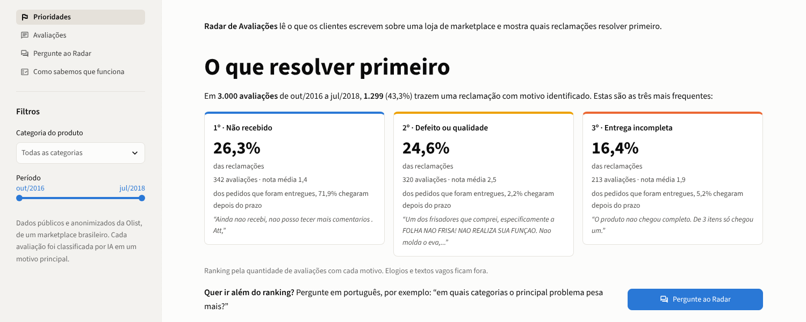
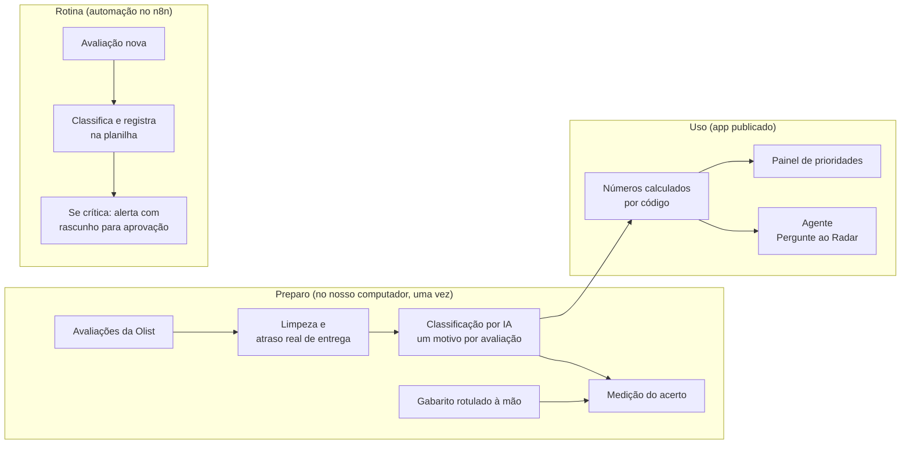
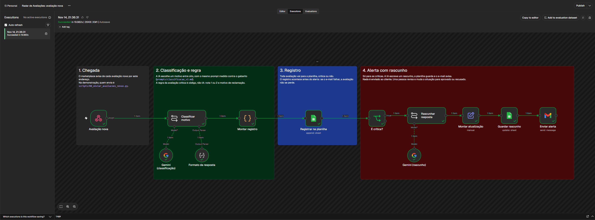

# Radar de Avaliações

**O que resolver primeiro?** O Radar lê as avaliações em texto livre de uma loja de marketplace, identifica o motivo de cada reclamação e mostra ao lojista por onde começar.

**[Abrir o app](https://radar-de-avaliacoes.streamlit.app)** (se o app estiver hibernando, clique em "Yes, get this app back up" e aguarde cerca de um minuto)

<!-- VIDEO: quando o vídeo estiver publicado, trocar esta linha por: **[Assistir à demonstração (3 min)](LINK)** -->


Projeto de portfólio construído entre 13 e 15 de novembro de 2026. É uma demonstração pública com dados abertos, e não uma ferramenta em uso em uma empresa.

## O problema

O lojista de marketplace recebe milhares de avaliações em texto livre. A nota em estrelas mostra que o cliente está insatisfeito, mas não diz o que resolver. Ler uma a uma não cabe na rotina, e o problema mais frequente fica escondido no volume.

## O que o Radar faz

| Parte | O que o lojista recebe | Onde ver |
|---|---|---|
| Painel de prioridades | As três reclamações mais frequentes na primeira tela, sem nenhum clique, com exemplos reais de cada uma | Página "Prioridades" do [app](https://radar-de-avaliacoes.streamlit.app) |
| Agente "Pergunte ao Radar" | Respostas em português a perguntas como "em quais categorias o defeito pesa mais?", com a consulta feita visível abaixo de cada resposta | Página "Pergunte ao Radar" do app |
| Automação | Cada avaliação nova é classificada e registrada em uma planilha. Se for crítica, chega um e-mail de alerta com um rascunho de resposta para aprovação | [automacao/](automacao/README.md) |
| Medição | O acerto da classificação, medido contra avaliações rotuladas à mão, com o que cada número não mostra | Página "Como sabemos que funciona" do app |

Na amostra de 3.000 avaliações do painel, 1.299 (43,3%) trazem uma reclamação com motivo identificado. As três mais frequentes:

| Prioridade | Avaliações | Parte das reclamações |
|---|---|---|
| 1. Não recebido | 342 | 26,3% |
| 2. Defeito ou qualidade | 320 | 24,6% |
| 3. Entrega incompleta | 213 | 16,4% |

## O que medimos

Cada resultado abaixo vem acompanhado do que ele não mostra.

| Pergunta | Resultado | O que o número não mostra |
|---|---|---|
| A IA acerta o motivo? | **137 de 150 (91,3%)** em avaliações rotuladas à mão, com o prompt v2. O v1 acertou 127 de 150 (84,7%) no mesmo gabarito | É otimista: escrevemos o v2 olhando os erros do v1 nessas mesmas avaliações |
| E em avaliações que o prompt nunca viu? | **53 de 60 (88,3%)** em validação às cegas, com intervalo de 95% de 77,8% a 94,2% | Os elogios são fáceis e puxam o número para cima. Só nas reclamações, o acerto é de **23 de 30 (76,7%)**, com intervalo de 59,1% a 88,2% |
| A classificação combina com o que aconteceu de fato? | Entre os pedidos entregues com avaliação classificada como atraso, 43,4% chegaram depois do prazo. Entre os elogios, 2,0%. A IA não viu as datas de entrega | É um sinal de coerência, e não uma medida de acerto |
| O agente inventa números? | Nas três perguntas de exemplo, todos os números vieram de consultas aos dados | São três perguntas. A conferência automática verifica a origem de cada número, e não se a frase em volta dele está bem escrita |
| A automação economiza tempo? | Em teste cronometrado, feito uma vez por uma pessoa, com 20 avaliações em cada forma, a triagem levou **11 min 36 s à mão e 2 min 47 s com a automação e revisão humana** | Boa parte dos 2 min 47 s é espera entre envios. A revisão rápida aprovou 4 rascunhos que afirmavam falha da loja antes de qualquer verificação. Não convertemos o resultado em horas por mês |
| A automação fez o que devia? | Das 20 avaliações registradas, nenhuma se repetiu e a regra da avaliação crítica foi aplicada igual à do nosso código em todas. O motivo coincidiu com o do classificador em lote em 19 de 20 | É a conferência de uma execução com 20 avaliações |

Na validação às cegas, revisamos as 7 discordâncias pela regra escrita: 5 eram erros do modelo, 1 era ambígua e 1 era rótulo nosso errado. Contando essas duas como acerto, o teto é de 55 de 60 (91,7%), e de 25 de 30 (83,3%) nas reclamações. O número principal continua sendo o original.

Detalhes de cada medição: [gabarito e revisão](docs/revisao_gabarito.md), [validação às cegas](docs/resultados/validacao_cega.md) e [revisão das discordâncias](docs/resultados/validacao_cega_revisao.md), [testes do agente](docs/resultados/teste_agente_v3.md), [teste cronometrado](docs/resultados/automacao_teste_cronometrado.md) e [conferência da automação](docs/resultados/automacao_conferencia.md).

## Como isso se aplicaria a um restaurante parceiro

Esta seção é uma hipótese. Os dados do projeto são de e-commerce geral, e não de delivery de comida. Não tivemos acesso a dados nem a sistemas de nenhuma plataforma de delivery, como o iFood.

A pergunta do lojista é a mesma de um restaurante parceiro: entre tantas avaliações, o que resolver primeiro? Os motivos que usamos têm equivalentes diretos em um pedido de delivery:

| Motivo no Radar | Equivalente em um pedido de delivery |
|---|---|
| Não recebido | Pedido não chegou |
| Entrega incompleta | Faltou item |
| Produto errado | Item trocado |
| Defeito ou qualidade | Comida fria, derramada ou abaixo do esperado |
| Atraso ou problema na entrega | Entrega depois do tempo previsto ou problema na entrega |
| Atendimento e pós-venda | Reembolso, cancelamento ou falta de resposta |

O que precisaria ser refeito antes de qualquer uso real: a taxonomia, com as reclamações próprias de comida; o gabarito, rotulado em avaliações de delivery; e a medição, do zero. No delivery o tempo também é outro. A avaliação chega minutos depois do pedido, então o alerta de avaliação crítica teria valor em horas, e não em dias.

## Como funciona





As regras de desenho que mais pesam no resultado:

- **Os números saem de código, nunca do modelo.** O painel e o agente usam as mesmas funções. A IA redige, mas não calcula, e uma conferência automática aponta qualquer número da resposta que não veio de uma consulta.
- **A IA classifica o motivo, mas não decide o que é crítico.** Avaliação crítica é uma regra fixa em código: nota 1 ou 2 e um motivo de reclamação. Na amostra do painel, ela separa 862 de 3.000 avaliações (28,7%).
- **Nenhuma resposta chega ao cliente sem aprovação de uma pessoa.** A IA gera um rascunho.
- **O registro acontece antes do alerta.** Se o e-mail falhar, a avaliação não se perde.
- **Avaliação vaga vai para "outro".** Preferimos admitir que não há informação a entregar um palpite.
- **O texto do cliente é tratado como dado.** Uma avaliação que tente dar ordens ao modelo é apenas classificada.

A organização do código e o motivo de cada decisão estão em [docs/arquitetura.md](docs/arquitetura.md). As regras de rotulagem estão em [docs/taxonomia.md](docs/taxonomia.md).

Tecnologias: Python, API do Gemini (saída estruturada e chamada de funções), Streamlit, n8n, Google Planilhas e Gmail. Usamos apenas a camada gratuita do Gemini, o que definiu a arquitetura: classificação em lotes de 25 avaliações, respostas guardadas em cache e um único arquivo com acesso ao modelo.

## Limitações

- Os dados são de 2016 a 2018 e de e-commerce geral. Nenhum lojista usou o Radar.
- Classificamos uma amostra de 3.000 avaliações, e não a base inteira, por causa do limite da camada gratuita.
- O acerto é menor justamente onde o painel mais depende dele: 76,7% nas reclamações, na validação às cegas. Os erros mais comuns são a reclamação leve que vira elogio e a confusão entre "não chegou", "atrasou" e "pós-venda".
- O rascunho de resposta tende a afirmar que houve falha da loja antes de qualquer verificação. No teste cronometrado, 4 dos 5 rascunhos fizeram isso e foram aprovados na revisão rápida. Só a conferência escrita, feita depois, encontrou o problema. O prompt de rascunho não foi medido contra um gabarito.
- O agente às vezes simplifica a frase em torno de um número correto. Por exemplo, escreveu "71,9% dos pedidos com esse motivo" quando o dado é "71,9% dos pedidos que foram entregues". A redação também varia entre rodadas.
- Reclamações com nota 3 ou mais não geram alerta. São 437 das 3.000 avaliações da amostra e ficam só no registro.
- A chegada de avaliações novas é simulada com 200 avaliações de agosto de 2018, reservadas para isso. Nenhum cliente real recebe resposta.
- Na automação, a classificação é feita uma avaliação por vez. O acerto foi medido em lotes de 25.
- O teste cronometrado é uma medição única: uma pessoa, uma vez, 20 avaliações em cada forma.
- O agente aceita 5 perguntas livres por sessão no app público, por causa da cota gratuita.

Próximos passos, nesta ordem: um prompt de rascunho que reconheça o relato sem afirmar a falha, avaliado em outras avaliações críticas; perguntas-armadilha para o agente; e um prompt v3 de classificação, medido em uma nova amostra às cegas.

## Como construímos com IA

O Radar usa IA em duas camadas, com papéis diferentes:

- **IA no produto:** o Gemini classifica as avaliações, conversa com o lojista no agente e redige os rascunhos de resposta. Cada uso foi medido ou tem uma conferência por código.
- **IA na construção:** escrevemos o código utilizando o Claude, em vibe coding. A IA propôs o código, e nós especificamos antes, testamos cada passo e medimos o resultado contra um gabarito feito à mão.

### Do zero ao produto em três dias

O histórico de commits registra a ordem real do trabalho:

| Quando | Commit | O que entrou |
|---|---|---|
| 13/11 | `d74b6f1` | Estrutura, taxonomia, arquitetura e acesso ao Gemini |
| 14/11 | `c372126` | Gabarito com 150 avaliações rotuladas à mão |
| 14/11 | `6afb207` | Classificador com saída estruturada e medição do prompt v1 |
| 14/11 | `b88ba60` | Prompt v2 com regras de decisão |
| 14/11 | `71eff7a` | App com as 3.000 avaliações classificadas |
| 14/11 | `c764a61`, `aa35050`, `ec6b888` | Agente, correção dos campos das ferramentas e instrução v3 |
| 14/11 | `4fe32dc` | Validação às cegas |
| 14/11 | `fc6c486` | Automação no n8n |
| 15/11 | `944290d` | Teste cronometrado e conferência da automação |

### O método

**1. Especificação antes do código.** A taxonomia dos oito motivos e o documento de arquitetura foram escritos no primeiro commit, antes de qualquer classificação. A taxonomia tem regras de decisão numeradas e um histórico de mudanças: cada ajuste registra a data, o motivo e as linhas do gabarito que precisaram ser revistas.

**2. Um passo pequeno por vez, sempre com teste.** Cada etapa terminou com testes passando e um commit. Hoje são 104 testes automatizados, e nenhum usa a rede: o Gemini é substituído por um cliente simulado. Assim conseguimos testar o cache, as novas tentativas, a divisão de lotes e a conversa do agente sem gastar cota.

**3. Os prompts são código.** Cada versão fica em `prompts/`, ao lado do resultado que obteve, e traz as próprias definições dos motivos. Um teste falha se o prompt v1 mudar depois de medido. Outro teste falha se o fluxo do n8n usar um prompt, uma lista de motivos ou uma regra de avaliação crítica diferente da que está no código.

**4. A régua não muda depois da medição.** Cada medição registra a impressão digital (hash) do gabarito usado, para só compararmos resultados feitos com a mesma régua. Depois do v2, o gabarito foi congelado. As 60 avaliações da validação às cegas nunca foram usadas para ajustar nenhum prompt, e um futuro v3 precisará de outra amostra.

**5. A saída do modelo é validada antes de ser usada.** A classificação usa saída estruturada da API: o modelo devolve JSON com o motivo dentro da lista de oito. Resposta fora do formato é rejeitada, e não corrigida em silêncio. Se um lote de 25 falha, ele é dividido ao meio até isolar a avaliação problemática, sem perder as outras.

**6. Cada requisição é contada.** A camada gratuita tem 500 requisições por dia por modelo, então um único arquivo (`src/radar/llm.py`) concentra todo o acesso ao Gemini: intervalo entre chamadas, novas tentativas em erros de cota, e cache das respostas já validadas, identificadas por hash. Um lote interrompido continua de onde parou, e a mesma pergunta não gasta cota duas vezes. As 3.000 avaliações do painel custaram 124 requisições.

**7. O agente pede, nosso código executa.** A execução automática de funções da biblioteca do Google fica desligada. O modelo escolhe entre quatro ferramentas, nosso código roda a consulta, limita a quatro rodadas por pergunta e mostra ao lojista o que foi consultado. Depois da resposta, uma conferência procura cada número do texto nos resultados das consultas.

**8. Medição antes de acreditar.** Todo número otimista ganhou uma medição mais dura depois. Os 91,3% do v2 ganharam a validação às cegas. A conferência com as datas reais de entrega testou a classificação com um dado que a IA não viu. O tempo da automação ganhou a conferência escrita dos rascunhos, que revelou o problema descrito nas limitações.

### O que não delegamos à IA

A IA escreveu código e classificou avaliações, mas não decidiu o que era certo. A régua, as regras e a palavra final ficaram conosco.

**Trabalho feito à mão**

- **Gabarito de 150 avaliações.** Sorteamos 30 por nota e rotulamos uma a uma, só pelo texto. A planilha de rotulagem não mostra a nota em estrelas nem a resposta do modelo. Marcamos 8 linhas como dúvida para rever depois, e um validador confere a planilha sem corrigir nada sozinho.
- **Validação às cegas com 60 avaliações.** Foram sorteadas da amostra do painel com semente fixa e rotuladas antes de qualquer comparação com o modelo. Elas nunca foram usadas para escrever nem para ajustar um prompt.
- **Triagem manual do teste cronometrado.** Lemos 20 avaliações novas, escolhemos o motivo de cada uma, marcamos as críticas pela regra e escrevemos as respostas. Levou 11 min 36 s e é a base de comparação da automação.
- **Revisão do que a automação produziu.** Conferimos o motivo de cada uma das 20 avaliações registradas, lemos os 5 rascunhos e mudamos a situação de cada um na planilha.
- **Leitura das respostas do agente.** A conferência automática verifica a origem dos números. Se a resposta faz sentido para um lojista, quem confere é uma pessoa.
- **Montagem da automação com as contas reais.** Criamos a planilha de registro, importamos o fluxo no n8n, conectamos Gemini, Google Planilhas e Gmail e publicamos o fluxo só durante os testes. A primeira execução completa percorreu os 12 nós em cerca de 20 segundos.

**Decisões que ficaram conosco**

- **O que cada motivo significa.** A taxonomia tem oito motivos e oito regras de decisão escritas. Quando a análise dos 26 erros do prompt v1 mostrou uma lacuna, mudamos a regra, e não só o prompt: problemas de entrega passaram a ser classificados pelo que o cliente viveu, e não por quem causou. Revimos 10 rótulos, cada um registrado com o valor anterior, o novo e o motivo.
- **O que é uma avaliação crítica.** É uma decisão de negócio, então virou uma regra fixa em código: nota 1 ou 2 e um motivo de reclamação.
- **Quando parar de ajustar.** Depois da medição do v2, congelamos o gabarito. Duas ambiguidades encontradas a partir daí foram registradas, e não corrigidas, para não ajustar a régua ao resultado. Pelo mesmo motivo, não alteramos o prompt de rascunho olhando os 5 casos em que o problema apareceu.
- **Qual número é o principal.** Na validação às cegas, revisamos as 7 discordâncias pela regra escrita. Mesmo com um rótulo nosso errado e um caso ambíguo, mantivemos o resultado original como número principal e o revisado apenas como teto.
- **O que chega ao cliente.** Nada sai sem a aprovação de uma pessoa. O teste cronometrado mostrou por que essa regra existe e também o limite dela.

### Onde erramos e como percebemos

| Problema | Como percebemos | O que mudamos |
|---|---|---|
| O prompt v1 confundia "não chegou" com "atrasou" | Lendo os 26 erros, um por um | Regras de desempate na taxonomia e no prompt v2 |
| O agente escreveu "342 de 1.299 avaliações", quando 1.299 é o total de reclamações | Nas perguntas de exemplo, rodadas com a API real (`scripts/05_testar_agente.py`) | Os nomes dos campos das ferramentas, e não o texto do prompt (`aa35050`) |
| Um rótulo nosso estava errado na validação às cegas | Revisão das discordâncias pela regra escrita | Nada no número principal: a revisão aparece só como teto |
| A revisão rápida aprovou rascunhos que afirmavam falha da loja | Conferência escrita, feita depois do teste | Registrado como limitação, com o próximo passo definido |

O que aprendemos em cada etapa, com o que faríamos diferente, está em [APRENDIZADOS.md](APRENDIZADOS.md).

## Como rodar

Requisitos: Python 3.10 ou superior.

```bash
python -m venv .venv
source .venv/Scripts/activate      # Windows (Git Bash). No Linux/macOS: source .venv/bin/activate
pip install -e ".[dev]"
pytest
```

Para abrir o app no computador, com os dados já processados do repositório:

```bash
python -m streamlit run app/app.py
```

O painel funciona sem chave. Para o agente e para as etapas que usam o Gemini, copie `.env.example` para `.env`, preencha `GEMINI_API_KEY` com uma chave do Google AI Studio e confira com `python scripts/00_testar_chave.py`.

Para refazer o preparo desde os dados brutos, baixe o conjunto de dados da Olist (link abaixo) e copie para `data/raw/` os arquivos `olist_order_reviews_dataset.csv` e `olist_orders_dataset.csv`. Depois:

```bash
python scripts/01_gerar_amostra.py         # cria data/gabarito/amostra_para_rotular.xlsx
python scripts/02_validar_gabarito.py      # confere a rotulagem e salva data/gabarito/gabarito.csv
python scripts/03_medir_prompt.py v2       # mede o prompt contra o gabarito (6 requisições)
python scripts/04_classificar_amostra.py   # 3.000 avaliações, cerca de 120 requisições
python scripts/05_testar_agente.py         # perguntas de exemplo do agente, com conferência dos números
python scripts/06_gerar_validacao_cega.py  # planilha da validação às cegas (60 avaliações do painel)
python scripts/07_medir_validacao_cega.py  # compara os rótulos às cegas com o modelo (0 requisições)
```

Para a automação (instruções completas em [automacao/README.md](automacao/README.md)):

```bash
python scripts/08_enviar_avaliacoes_novas.py --nota 1   # envia 1 avaliação nova ao webhook do n8n
python scripts/09_conferir_automacao.py registro.csv    # confere o registro gravado pelo n8n (0 requisições)
```

**Publicação no Streamlit Community Cloud.** O servidor recarrega sozinho apenas a pasta `app/`. Depois de um push que mude arquivos de `src/radar/`, é preciso reiniciar o app em Manage app, Reboot app.

## Dados

[Brazilian E-Commerce Public Dataset by Olist](https://www.kaggle.com/datasets/olistbr/brazilian-ecommerce), com pedidos reais e anonimizados feitos entre 2016 e 2018. O painel usa uma amostra de 3.000 avaliações com texto, de outubro de 2016 a julho de 2018. Os dados brutos não são versionados neste repositório.

## Estrutura

```
src/radar/     regras do produto, sem interface (dados, acesso ao Gemini, classificador, métricas, agente e automação)
app/           app em Streamlit (só lê dados processados; todos os números vêm de src/radar/metricas.py)
prompts/       versões dos prompts de classificação, do agente e do rascunho
scripts/       passos do projeto, numerados na ordem de execução
tests/         testes automatizados
automacao/     fluxo do n8n e instruções da automação
docs/          taxonomia, arquitetura, resultados das medições e imagens
data/          dados brutos (fora do Git), gabarito, validação e dados processados para o app
```
