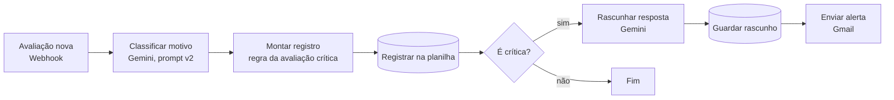
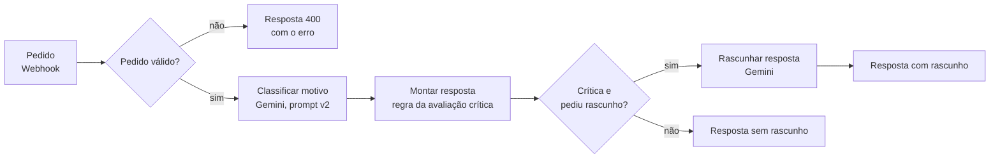

# Automação: o que acontece quando chega uma avaliação nova

O painel mostra o que já aconteceu. Esta automação trata o que chega: cada avaliação nova é classificada, registrada e, se for crítica, vira um alerta por e-mail com um rascunho de resposta para aprovação.

O fluxo roda no [n8n](https://n8n.io). O arquivo `fluxo_radar.json` desta pasta é o fluxo completo, pronto para importar.

## O fluxo em quatro partes



| Nó | O que faz | Por que é assim |
|---|---|---|
| Avaliação nova (Webhook) | Recebe uma avaliação por requisição POST e responde na hora | É como um marketplace avisaria um sistema. Na demonstração, quem envia é `scripts/08_enviar_avaliacoes_novas.py` |
| Classificar motivo | Envia ao Gemini o prompt `prompts/classificacao_v2.md`, sem alteração, com a avaliação no lugar do lote | É o prompt medido contra o gabarito. A avaliação entra como dado, em JSON |
| Gemini (classificação) | Modelo `gemini-3.5-flash-lite`, temperatura 0 | Mesmo modelo e mesma temperatura da classificação do painel |
| Formato da resposta | Obriga a resposta a ter um motivo dentro da lista de oito | Resposta fora do formato interrompe a execução, em vez de gravar um motivo inventado |
| Montar registro (Code) | Junta a avaliação com o motivo e aplica a regra da avaliação crítica | A regra é código, e não IA: nota 1 ou 2 e um motivo de reclamação. É a mesma de `src/radar/automacao.py` |
| Registrar na planilha | Acrescenta uma linha na aba `registro` | O registro acontece antes do alerta. Se o e-mail falhar, a avaliação não se perde |
| É crítica? | Segue para o rascunho só quando a regra deu verdadeiro | Avaliação não crítica termina aqui, sem gastar outra requisição |
| Rascunhar resposta | Envia ao Gemini o prompt `prompts/rascunho_v1.md` | O rascunho não promete reembolso, troca nem prazo: essa decisão é da loja |
| Gemini (rascunho) | Modelo `gemini-3.1-flash-lite` | Cota separada da classificação |
| Montar atualização | Prepara o rascunho e a situação "aguardando aprovação" | Só três campos: `review_id`, `rascunho` e `situacao` |
| Guardar rascunho | Atualiza a linha da avaliação, localizada pelo `review_id` | O rascunho fica na planilha mesmo que o e-mail falhe |
| Enviar alerta (Gmail) | Envia o alerta para a pessoa responsável | Nada é enviado ao cliente. Uma pessoa revisa e muda a situação para `aprovado` ou `recusado` |

## O que já foi testado

Primeiro, em 14/11/2026, em uma instalação local do n8n 2.35.7, com o Gemini simulado por um servidor de teste:

- O arquivo importa sem erro e os 12 nós aparecem ligados.
- O prompt chega ao modelo igual ao arquivo `classificacao_v2.md`, com a avaliação como dado.
- A regra separa certo os casos: nota 1 com reclamação segue para o rascunho; nota 5, nota 3 com reclamação e nota 1 com elogio terminam no registro.
- Texto com chaves, aspas, quebra de linha e uma ordem escondida passa como dado, sem quebrar o fluxo.
- O assunto e o corpo do e-mail são montados com os campos certos.

Depois, no mesmo dia, no n8n Cloud com as contas reais (Gemini, Google Planilhas e Gmail):

- Uma avaliação de nota 1 percorreu os 12 nós em cerca de 20 segundos: motivo correto, linha registrada na planilha e e-mail de alerta recebido com o rascunho. Os prints estão em `docs/imagens/`.
- No teste cronometrado, 20 avaliações enviadas com o fluxo publicado foram registradas sem erro, e a conferência do script 09 não encontrou nenhum problema. O resultado está em `docs/resultados/automacao_teste_cronometrado.md` e `docs/resultados/automacao_conferencia.md`.

Os testes automatizados do repositório (`tests/test_fluxo_n8n.py`) conferem que o fluxo usa os mesmos prompts, a mesma lista de motivos e a mesma regra do código.

## Preparação (uma vez)

### 1. Planilha de registro

Crie uma planilha no Google Planilhas chamada `Radar - registro de avaliações`. Renomeie a aba para `registro` e escreva na linha 1, uma palavra por coluna, nesta ordem:

```
review_id	data_avaliacao	nota	categoria	texto	motivo	motivo_nome	critica	situacao	rascunho	processada_em
```

Dica: copie a linha acima e cole na célula A1. Os nomes precisam ser exatamente esses, porque o n8n preenche cada coluna pelo nome.

### 2. Conta e importação

1. Crie a conta no n8n Cloud (teste gratuito de 14 dias).
2. Crie um workflow novo, abra o menu de três pontos e escolha **Import from File**. Selecione `automacao/fluxo_radar.json`.

### 3. Credenciais

Os nós com um triângulo vermelho estão sem credencial.

| Nó | Credencial | Como criar |
|---|---|---|
| Gemini (classificação) e Gemini (rascunho) | Google Gemini (PaLM) API | Cole uma chave do Google AI Studio. Crie uma chave só para o n8n, no mesmo projeto, para poder revogá-la sem afetar o app |
| Registrar na planilha e Guardar rascunho | Google Sheets | Botão **Sign in with Google** |
| Enviar alerta | Gmail | Botão **Sign in with Google** |

### 4. Ajustes nos nós

1. **Avaliação nova:** troque o Path `radar-avaliacao-nova` por uma sequência só sua, com letras e números misturados. O caminho que está neste arquivo é público, porque o repositório é público.
2. **Registrar na planilha:** em Document, escolha a planilha. Em Sheet, escolha `registro`. Confira: Mapping Column Mode em **Map Automatically** e, em Options, Cell Format em **Let n8n format**.
3. **Guardar rascunho:** escolha a mesma planilha e a mesma aba. Confira: Mapping Column Mode em **Map Automatically** e Column to match on em **review_id**.
4. **Enviar alerta:** troque `SEU_EMAIL@exemplo.com` pelo seu e-mail.
5. **Gemini (classificação) e Gemini (rascunho):** abra cada um e confira se o modelo aparece selecionado.

O formato **Let n8n format** grava o texto do cliente como texto puro. Sem ele, uma avaliação que comece com `=` seria lida pela planilha como fórmula.

## Primeiro teste, com uma avaliação

1. Abra o nó **Avaliação nova**, copie a **Test URL** e cole no arquivo `.env`:
   ```
   N8N_WEBHOOK_URL=https://...
   ```
2. No n8n, clique em **Execute workflow**. O fluxo fica escutando por até 120 segundos.
3. No terminal, com o ambiente virtual ativo:
   ```bash
   python scripts/08_enviar_avaliacoes_novas.py --nota 1
   ```
4. Confira: os nós ficam verdes, uma linha aparece na planilha e o e-mail de alerta chega.

O endereço de teste aceita uma chamada por vez. Para repetir, clique em **Execute workflow** de novo antes de cada envio. Clique em cada nó para ver o que entrou e o que saiu: é a melhor forma de entender o fluxo.

## Rodando de verdade

Antes, apague da planilha as linhas dos testes. A avaliação do primeiro teste também está entre as 20 do envio, e a conferência apontaria a linha repetida.

1. Clique em **Publish** no n8n.
2. No nó **Avaliação nova**, copie a **Production URL** e troque o valor de `N8N_WEBHOOK_URL` no `.env`.
3. Envie as avaliações:
   ```bash
   python scripts/08_enviar_avaliacoes_novas.py --quantidade 20
   ```
4. Acompanhe na aba **Executions** do n8n, na planilha e no e-mail.
5. Ao terminar a sessão de testes, despublique o fluxo.

O script espera 8 segundos entre os envios. Cada avaliação gasta 1 requisição de classificação, e cada avaliação crítica gasta mais 1 de rascunho, em modelos com cotas separadas.

## API: a mesma classificação, chamada por qualquer sistema

O arquivo `fluxo_api.json` é um segundo fluxo, independente do primeiro. Ele recebe uma avaliação e responde na hora, sem gravar nada: não usa planilha nem e-mail. É a forma de outro sistema, como uma tela feita em v0, usar o Radar sem um servidor próprio.



**Pedido** (POST, JSON):

```json
{"texto": "O pedido está como se fosse entregue, mas não recebi nada", "nota": 1, "incluir_rascunho": true}
```

`texto` é obrigatório (até 2.000 caracteres), `nota` é um inteiro de 1 a 5 e `incluir_rascunho` é opcional (padrão: `true`). Pedido fora disso recebe erro 400 com a explicação, sem gastar cota do Gemini.

**Resposta:**

```json
{
  "motivo": "nao_recebido",
  "motivo_nome": "Não recebido",
  "nota": 1,
  "critica": true,
  "precisa_de_rascunho": true,
  "rascunho": "Olá! Sentimos muito ...",
  "aviso": "Classificação e rascunho feitos por IA. O rascunho precisa de revisão e aprovação de uma pessoa antes de qualquer envio ao cliente.",
  "versao": {"prompt": "classificacao_v2", "modelo": "gemini-3.5-flash-lite"}
}
```

Os testes do repositório (`tests/test_fluxo_api.py`) conferem que este fluxo usa o mesmo prompt, a mesma lista de motivos, a mesma regra e os mesmos modelos do código, e que não traz credenciais.

### Como publicar

1. No n8n, crie um workflow novo e importe `automacao/fluxo_api.json`.
2. Nos nós **Gemini (classificação)** e **Gemini (rascunho)**, escolha a mesma credencial do Gemini do outro fluxo.
3. No nó **Pedido (API)**, troque o Path `radar-api` por uma sequência só sua. Em Options, confira **Allowed Origins (CORS)** com `*`, para a tela no navegador conseguir chamar a API.
4. Clique em **Publish** e copie a **Production URL** do nó **Pedido (API)**.
5. Cole no `.env` como `RADAR_API_URL=...` e confira com `python scripts/11_testar_api.py --uma`.

Cuidados que valem para a API:

- O endereço fica visível no código da tela, e quem o tem consegue chamar a API e gastar a cota gratuita do Gemini. Cada chamada gasta 1 requisição de classificação, e as críticas com rascunho gastam mais 1. Para desligar, despublique o fluxo.
- O fluxo roda no teste gratuito do n8n Cloud, de 14 dias. Depois disso, a API sai do ar.

## Teste cronometrado

O teste compara o tempo de uma pessoa para tratar 20 avaliações à mão com o tempo para revisar o resultado da automação em outras 20. Usamos dois conjuntos diferentes, sorteados da mesma forma, para a pessoa não rever avaliações que já leu.

**À mão (conjunto A):**

```bash
python scripts/08_enviar_avaliacoes_novas.py --quantidade 20 --inicio 20 --salvar triagem_manual.csv
```

Abra o arquivo em uma planilha. Ligue o cronômetro e, para cada avaliação: leia, escreva o motivo (um dos oito), marque se é crítica pela regra e escreva a resposta das críticas. Pare o cronômetro ao terminar a última.

**Com a automação (conjunto B):**

```bash
python scripts/08_enviar_avaliacoes_novas.py --quantidade 20
```

Ligue o cronômetro ao rodar o comando. Quando as 20 linhas estiverem na planilha, revise cada uma: confira o motivo, leia cada rascunho e mude a situação para `aprovado` ou `recusado`. Pare o cronômetro ao terminar a última.

**O que anotar em `docs/resultados/automacao_teste_cronometrado.md`:** os dois tempos, quantas críticas havia em cada conjunto, de quantos motivos você discordou e quantos rascunhos recusou.

**Como descrevemos o resultado:** "Em teste cronometrado, feito uma vez por uma pessoa, com 20 avaliações em cada forma, a triagem levou X minutos à mão e Y minutos com a automação e revisão humana." Não convertemos esse número em horas por mês sem declarar a suposição de volume.

## Conferência do registro

Depois dos envios, baixe a aba `registro` como CSV (Arquivo, Fazer download, Valores separados por vírgula) e rode:

```bash
python scripts/09_conferir_automacao.py caminho/do/arquivo.csv
```

O script confere, pelo nosso código, se cada linha é uma avaliação que enviamos, se nenhuma se repete, se a regra da avaliação crítica foi aplicada igual à nossa e se toda crítica tem rascunho. Não gasta cota.

Com `--comparar`, ele classifica as mesmas avaliações com o classificador do projeto, em lote, e conta em quantas o n8n chegou ao mesmo motivo. Gasta 1 requisição para cada 25 avaliações. O resumo vai para `docs/resultados/automacao_conferencia.md`.

## Cuidados

- **O endereço do webhook é um segredo.** Quem tem o endereço consegue disparar o fluxo e gastar a cota. Por isso trocamos o caminho público deste arquivo por um próprio, que fica só no `.env`. O endereço não aparece no vídeo, e o fluxo fica despublicado fora dos testes.
- **Antes de versionar um fluxo exportado do n8n,** troque o seu e-mail por `SEU_EMAIL@exemplo.com` e apague o identificador da planilha. O teste `tests/test_fluxo_n8n.py` falha se o arquivo trouxer e-mail, credencial ou planilha.
- **Reenviar a mesma avaliação cria uma linha repetida.** A conferência aponta as repetições.

## Limitações

- O n8n classifica uma avaliação por vez. O acerto do prompt foi medido em lotes de 25. A comparação do passo 9 mostra se isso muda o motivo.
- O n8n acrescenta ao prompt as instruções de formato dele. A classificação do painel usa o esquema nativo da API do Gemini.
- O prompt de rascunho (`rascunho_v1`) não foi medido. A proteção é a revisão humana: nenhum rascunho é enviado ao cliente.
- O `rascunho_v1` tende a afirmar que houve falha da loja antes de qualquer verificação. No teste cronometrado, 4 dos 5 rascunhos fizeram isso e foram aprovados na revisão feita durante a chegada das avaliações. O próximo passo é um `rascunho_v2` que reconheça o relato sem afirmar a falha, avaliado em outras avaliações críticas.
- Reclamações com nota 3 ou mais não geram alerta. Na amostra do painel elas são 437 de 3.000. Ficam registradas na planilha.
- O webhook não tem autenticação. Em uso real, exigiria um cabeçalho com segredo.
- A chegada das avaliações é simulada com dados públicos de 2018. Nenhum cliente real recebe resposta.
