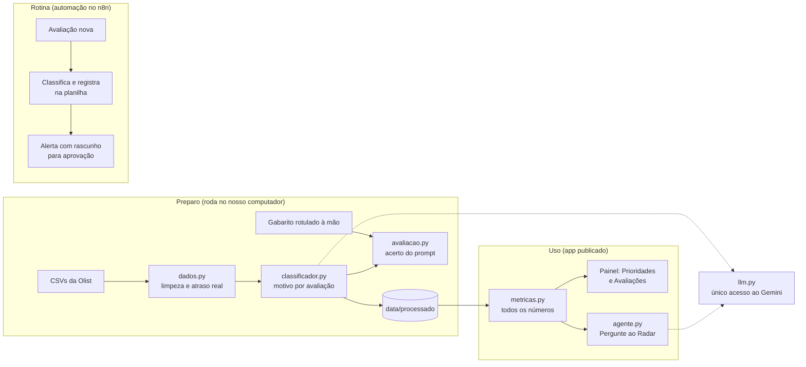

# Arquitetura do Radar de Avaliações

Este documento registra como organizamos o projeto e por quê. Ele foi escrito antes do código das próximas etapas e é atualizado sempre que uma decisão mudar.

## O que o produto faz

O lojista de marketplace recebe milhares de avaliações em texto livre. O Radar lê essas avaliações, identifica o motivo principal de cada uma e responde à pergunta: "o que devo consertar primeiro?".

## Visão geral



O projeto tem três momentos separados:

1. **Preparo.** Lemos os dados, classificamos uma amostra e medimos o acerto contra o gabarito. Roda no nosso computador, uma vez, e grava o resultado em `data/processado/`.
2. **Uso.** O app publicado carrega apenas os dados já processados. O painel não chama a IA. Só o agente chama, e com limite por sessão. Uma página de apresentação estática serve de porta de entrada para o app.
3. **Rotina.** A automação trata cada avaliação nova: classifica, registra e, se for crítica, gera um alerta com rascunho de resposta.

## Estrutura de pastas

Os itens marcados com (a criar) entram nas próximas etapas.

```
radar-de-avaliacoes/
├── src/radar/              regras do produto, sem interface
│   ├── config.py           caminhos, categorias e parâmetros
│   ├── dados.py            leitura e limpeza dos dados
│   ├── llm.py              único ponto de acesso ao Gemini (cache, intervalo e novas tentativas)
│   ├── classificador.py    prompt, saída estruturada, lotes e validação
│   ├── avaliacao.py        compara a classificação com o gabarito
│   ├── metricas.py         todos os números do painel e do agente
│   └── agente.py           (a criar) ferramentas e conversa com o lojista
├── prompts/                versões do prompt em arquivos de texto
├── scripts/                etapas do preparo, numeradas na ordem de execução
├── app/                    app em Streamlit: app.py, comum.py e paginas/
├── site/                   (a criar) página de apresentação estática (GitHub Pages)
├── automacao/              (a criar) fluxo do n8n exportado e instruções
├── tests/                  testes automatizados
├── docs/                   taxonomia, arquitetura e resultados
└── data/
    ├── raw/                dados brutos da Olist (fora do Git)
    ├── gabarito/           amostra rotulada à mão
    ├── cache/              respostas do Gemini já obtidas (fora do Git)
    └── processado/         amostra classificada (painel) e avaliações novas (automação)
```

## Decisões de desenho

| Decisão | Motivo |
|---|---|
| Os números saem de código, nunca do modelo | O painel e o agente usam as mesmas funções de `metricas.py`. A IA redige, mas não calcula. Assim o agente não inventa número e os dois lugares mostram sempre o mesmo valor. |
| Um único ponto de acesso ao Gemini (`llm.py`) | Cache, intervalo entre requisições, novas tentativas e contagem de requisições ficam em um só arquivo. A camada gratuita tem limite diário, então cada chamada precisa ser contada. |
| Respostas guardadas em cache | A mesma pergunta ao mesmo modelo não gasta cota duas vezes, e um lote interrompido continua de onde parou. Só entram no cache respostas que passaram pela validação. |
| Avaliações numeradas dentro do lote | O modelo devolve um número curto (1 a 25) em vez do identificador original. Gasta menos tokens e facilita conferir se alguma avaliação ficou sem resposta. |
| Texto da avaliação tratado como dado | O prompt avisa que o texto do cliente não é instrução. Uma avaliação que tente dar ordens ao modelo é apenas classificada. |
| Preparo separado do uso | O app publicado tem pouca memória e hiberna. Carregando dados já processados, ele abre rápido e não gasta cota para mostrar o painel. |
| Regras do produto separadas da interface | `src/radar` não conhece o Streamlit nem o n8n. Podemos testar cada função sozinha e trocar a interface sem reescrever a lógica. |
| Prompts em arquivos versionados | Cada versão do prompt fica no histórico do Git ao lado do resultado que ela obteve. Cada arquivo traz as próprias definições dos motivos, então uma versão já medida não muda quando a taxonomia evolui. Um teste confere que o v1 continua idêntico ao que foi medido. |
| Saída do modelo validada antes de ser usada | Toda resposta passa por um esquema (motivo dentro da lista de oito). Resposta fora do formato é rejeitada, não corrigida em silêncio. |
| Avaliação vaga vai para "outro" | Preferimos admitir que não há informação a entregar um palpite ao lojista. |
| Nenhuma resposta ao cliente sai sem aprovação | A IA gera rascunho. Quem envia é uma pessoa. |
| Página de apresentação separada do app | A página estática não hiberna e é o link que divulgamos. Ela leva ao app e ao repositório. Qualquer número que ela mostre vem de um arquivo gerado pelo nosso código. |
| Streamlit agora, front-end próprio depois | Um front-end próprio exige um servidor para o agente, porque a chave não pode ficar no navegador. Priorizamos o que funciona no prazo e deixamos essa troca como próximo passo. |
| Chave da API fora do repositório | Fica no arquivo `.env` (local) e nos segredos do serviço (app publicado). O `.gitignore` impede o envio por engano. |

## Como sabemos que cada parte funciona

| Parte | Verificação |
|---|---|
| Tratamento de dados | Testes automatizados (`pytest`) |
| Classificação | Acerto medido contra 150 avaliações rotuladas à mão, com duas versões de prompt (`scripts/03_medir_prompt.py`, resultados em `docs/resultados/`). Cada resumo registra a impressão digital do gabarito usado, para só compararmos medições feitas com a mesma régua. Montagem do prompt, validação e lotes cobertos por testes sem rede |
| Acesso ao Gemini | Testes de cache, intervalo e novas tentativas com um cliente simulado |
| Números do painel | Testes das funções de `metricas.py` com dados pequenos e resultado conferido à mão |
| Coerência da classificação | Na página Prioridades, comparamos os motivos dados pela IA com as datas reais de entrega, que a IA não viu |
| Agente | Três perguntas de exemplo com resposta conferida contra o painel |
| Automação | Uma avaliação crítica entra e o alerta chega, em teste cronometrado |

## Limitações conhecidas

- Os dados são de 2016 a 2018 e de e-commerce geral, não de delivery de comida.
- Classificamos uma amostra, não a base inteira, por causa do limite da camada gratuita.
- A chegada de avaliações novas é simulada com uma parte da base separada para isso.
- O app é uma demonstração pública com dados abertos, não uma ferramenta em uso em uma empresa.
